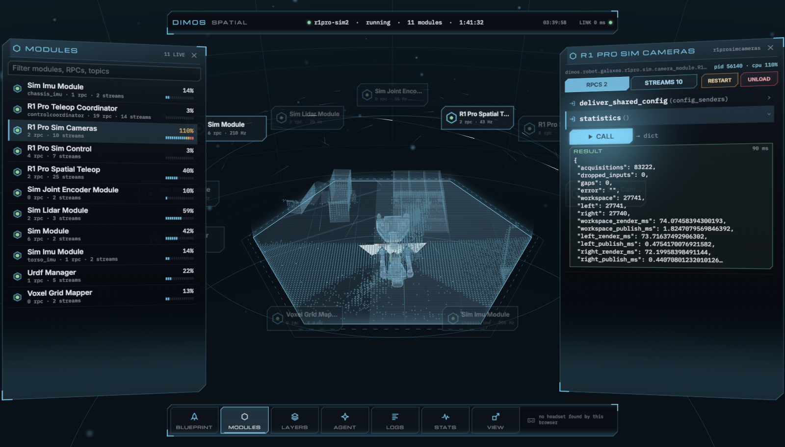
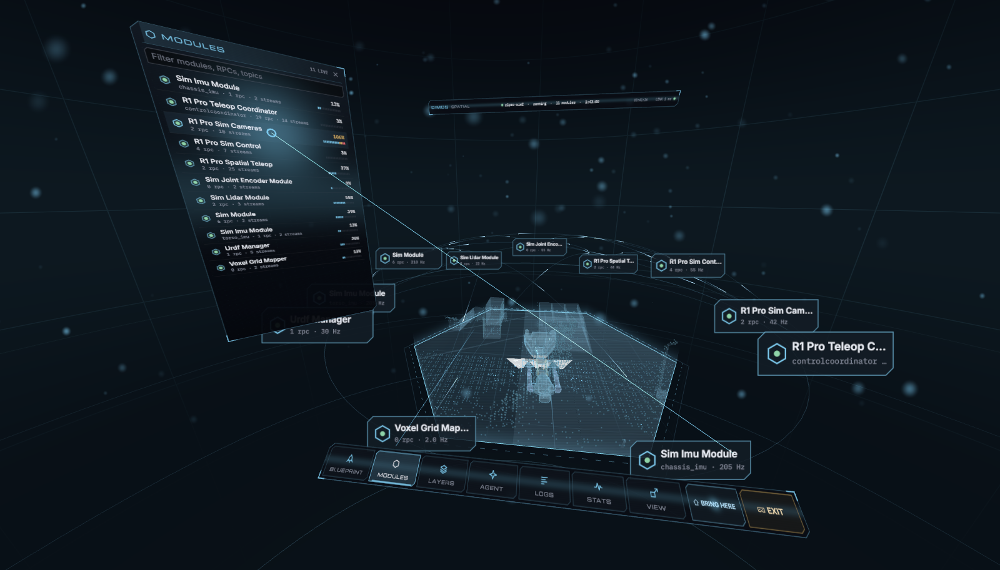
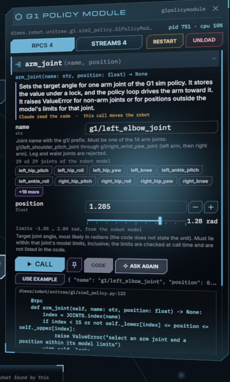
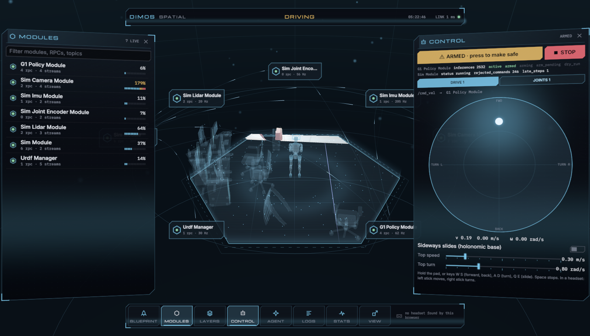
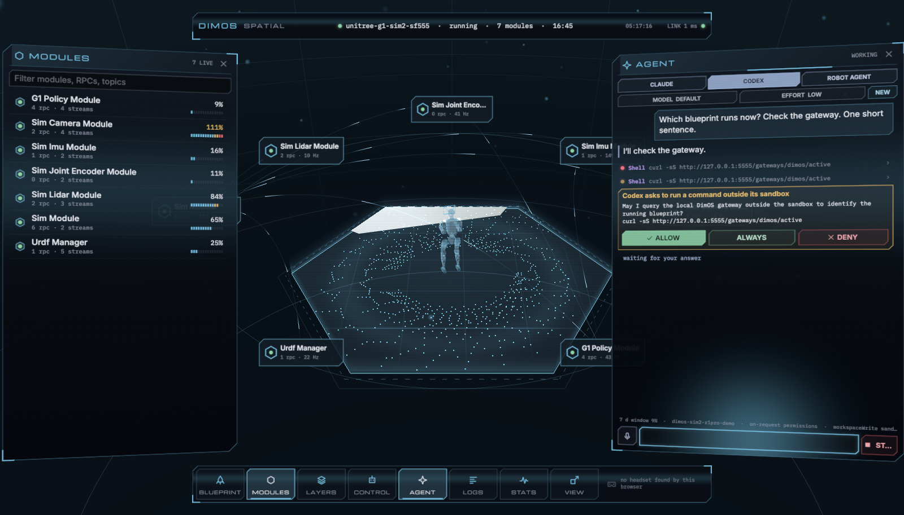
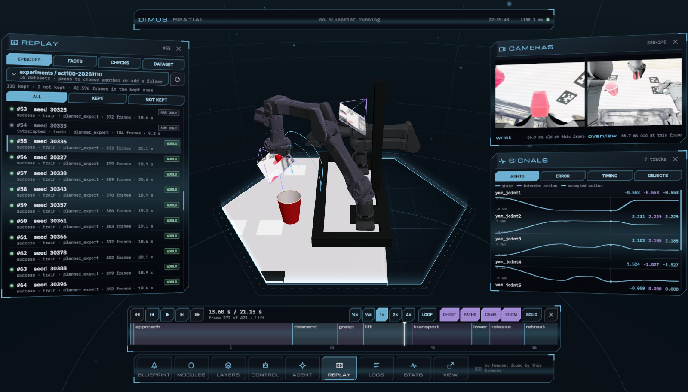

# Spatial Desktop

DimOS Desktop in space. The running blueprint is drawn as holograms: on a flat screen it is a cockpit
around a table, in a headset (WebXR) it is a room you stand in. Nothing in it is written for a robot:
every panel and every hologram is built from what the dimos gateway says is running.





## What it shows

- **Blueprint**: the catalog, launch, stop and restart (through Desktop's Launcher, so a launch gets your saved config).
- **Modules**: every module instance of the run, as a list and as a ring of plates around the table. An arc
  joins two modules that share a topic; pulses run from writer to reader at the topic's measured rate.
- **A module**: its docstring, process and CPU, its streams with live rates, and its RPCs (below).
  Restart and Unload need a second press.
- **Layers**: the streams that have a drawing, placed by tf.

  | message | drawn as |
  |---|---|
  | `sensor_msgs.PointCloud2` | points coloured by height (a dense map as dots, a scan as light) |
  | depth `Image` + colour `Image` + `CameraInfo` | a textured surface where the camera sees it |
  | `sensor_msgs.Image` alone | a frustum with the picture on its far end |
  | URDF from `UrdfManager` (`/render_file_request`, `/file_info`) | the robot as a hologram or a solid; other models as scenery |
  | `nav_msgs.Odometry`, `PoseStamped` | a marker with a trail |
  | `nav_msgs.Path`, `nav_msgs.OccupancyGrid` | a line, a textured plane |
  | `tf2_msgs.TFMessage` | frame axes |

- **Control**: the robot's controls, found from the blueprint (below).
- **Agent**: a chat with Claude Code or Codex on this machine, or with the agent of an agentic blueprint (below).
- **Replay**: recorded episodes instead of the live blueprint: the world, the cameras and every signal at a
  playhead you can scrub, with checks of the episode and of the whole dataset (below).
- **Logs**, **Load** (per-process CPU and memory, per-topic rate and bytes) and **View** (scale, floor, lid, life size).

Desktop is told what the app shows, so an agent that asks Desktop can know what you are looking at, and
`POST /gateways/desktop/views/<app>/highlight {"kind": "module", "id": "<module id>"}` flashes that module.

## Calling an RPC



An RPC opens into a form made from its signature. The form is built so that nothing has to be guessed:

- **The editor fits the type.** `bool` is a switch, `Literal`/`Enum` are choices, `list[float]` and tuples
  are typed as `0.1, 0.2, 0.3`, `list[str]` as `a, b`, `dict` as `key=value, other=2`. No JSON is needed
  (it is still accepted).
- **Help comes from the docstring** (`Args:`), next to each parameter.
- **Values come from what runs.** A parameter that names a joint, a frame, a topic or a module lists the
  ones that exist; typing narrows the list. A position next to a chosen joint gets a slider over that
  joint's limits from the robot model.
- **CODE** shows the method's Python source from the dimos checkout Desktop runs.
- **EXPLAIN** hands the signature and the source to Claude Code or Codex. The answer says what the call
  does, what each parameter means and whether it moves the robot, and gives values that work
  (**USE EXAMPLE**). It is kept for the next time that class runs.
- **A Python object cannot be sent from a page** (the gateway passes JSON through). For such a parameter
  (`Twist`, `PoseStamped`) the form says so, names the stream of the same type the module reads, and
  **HAND TO AGENT** puts the call in the agent's chat.
- The pin puts a filled-in call into **Control → ACTIONS** as one button. The last values that worked are remembered.

RPCs that the blueprint's own start-up calls (`deliver_*`) fold away under the others.

## Driving the robot



**CONTROL** is built from the streams the modules read and the RPCs they offer:

| the blueprint has | Control shows |
|---|---|
| a `Twist` stream a module reads | **DRIVE**: a pad, keys `W S` (forward, back) `A D` (turn) `Q E` (slide), `Space` stops; in a headset the left stick moves and the right stick turns |
| `Float32`, `Int32`, `Bool` streams | **SET**: a slider or a switch (below) |
| a `PoseStamped` or `PointStamped` navigation goal | **SET**: POINT AT IT, then press a place on the table |
| a `JointState` command stream, or an RPC `(name: str, position: float)` | **JOINTS**: a slider per joint over its limits, with the measured position marked |
| RPCs that need no arguments, and pinned calls | **ACTIONS**: one button each |
| `status()` RPCs | a line of what each module reports, read while the panel is open |

A stream of numbers does not say what its number means. Each slider has two settings for that: its range,
and whether the value **STAYS SET** (a set point, sent when it changes) or acts only **WHILE HELD** (a rate,
sent for as long as you hold the slider, then zero). **ASK WHAT IT EXPECTS** has Claude Code or Codex read
the handler in the code and set both, with a line that says what the number does.

Nothing is sent until you press **ARM**. A drive publishes only while the pad, a key or a stick is held;
the first input stores a stop command on Desktop's gateway, which sends it if the page goes away. **STOP**
sends zero on every drive stream. Closing the panel makes the controls safe.

One app at a time may command a robot (the gateway's lease). The first command takes it, also from
another app such as Controller; if another app takes it back, the panel says so and your next press
takes it again.

## Agents



**AGENT** has three tabs:

- **CLAUDE** and **CODEX**: the app's server starts Claude Code (`claude`) or Codex (`codex`) on this machine,
  in the dimos checkout Desktop uses, with the login that program already has (your subscription; no API
  key is used, and one in the environment is removed). It is the same agent as in a terminal, with your
  settings, skills and MCP servers. Text streams in, each tool call is a row you can open, and a
  permission prompt is a card with ALLOW and DENY (Codex also ALWAYS, for the session). STOP ends a turn.
  MODEL and EFFORT apply to the next session; CONTINUE LAST resumes the last conversation.
- **ROBOT AGENT**: the agent inside an agentic blueprint (`/human_input`, `/agent`, `/agent_idle`).

The agent is told where Desktop's gateways are and what you have on screen. Codex runs commands in its
sandbox, which has no network, so it asks before a command that reaches the gateway.
Desktop's own agent (dimcode) and the `dimos agent` harness are not wired in.

## Replay



**REPLAY** shows recorded episodes in place of the live blueprint. A dataset is a folder named `episodes`
whose subfolders each hold a `metadata.json` and an MCAP of frames, as dimos's learning loop writes them
(one JSON frame per control step: joint state, action, camera images, time stamps). Datasets under
Desktop's app data are found by themselves. Any other folder is added by its path.

An open episode has:

- **The deck**, above the command bar: play, step, speed (¼× to 4×), loop, and a timeline with the
  episode's phases and what the checks flagged. Drag on it to scrub. `Space` plays and pauses, `←` `→`
  step one frame (with Shift one second), `Home` and `End` jump to the ends. Time is the episode's control
  clock. It is not the MCAP's log time, which for an episode rendered offline is the wall clock of the render.
- **Cameras**: each camera's picture at the playhead, and how old it was when the state was read.
- **Signals**: every recorded quantity over the whole episode, with the playhead on it. Joint state against
  the actions, the state one step after a command against that command, image ages, object positions.
  Press or drag in a track to go there.
- **The world on the table**, when the episode names a sim2 run record: the shapes of its compiled MuJoCo
  model with every body where it was. The deck's switches add the pose the command asked for (**GHOST**),
  the path of each thing that travelled (**PATHS**), each camera as a frustum with its picture (**CAMS**)
  and the fixed surroundings (**ROOM**), and choose a solid or a hologram look.
- **Facts**: `metadata.json` and the simulation record, as they were written.
- **Checks** (below), and a button that hands the episode to a coding agent.

Where the world comes from depends on what was saved with the episode:

| the episode has | the table shows |
|---|---|
| a world history (`world-history.npz`) | **WORLD**: every body at every snapshot, restored by dimos's own sim2 reader |
| no history, but its list of commands (`trajectory.npz`) | **ARM ONLY**: the robot from its recorded joint states; objects stay where they started. **RUN THE PHYSICS AGAIN** repeats the episode in sim2 from the recorded start and commands (no cameras, about 15 s), compares the joint states it gets with the recorded ones, and then shows the whole world (**RE-SIM**) with that comparison |
| no simulation record | no world; cameras and signals only |

### Checks

**CHECKS** reports on the open episode. Each line says what was tested and what was found:
the file's hash against `metadata.json`; the frame count; a steady control clock; every command applied;
accepted action equal to intended action; actions inside the joint limits; no jumps in the joint state;
for each camera an image in every frame, of the declared size, new in every frame, taken at most 150 ms
before the state and delivered before it; the recorded joint state against the world history; the outcome
against the physical validation. A failing frame is marked on the timeline.

**DATASET → CHECK EVERY EPISODE** runs the same checks on all episodes (about 0.3 s each) and adds what
only shows across them: one data contract (joint names, rate, image shape, cameras, action meaning), a
seed and a file of its own for each episode, and whether the kept episodes are a fair sample of what was
tried. When a generation report lies beside the episodes it draws what became of every attempt, where
each object was placed in kept and rejected attempts, and each sampled quantity for kept against not kept.

### How it reads

The server lists datasets from their `metadata.json` files. An episode is read by a Python process
(`server/replay/worker.py`) started with the runtime that wrote it: the virtual environment of the dimos
checkout named in the episode's simulation record, so the model loads with the MuJoCo that compiled it.
Nothing is written into a dataset. A re-simulated world and a dataset check are kept under this app's own
data folder (`replay/`).

## Scenes

**SCENES** puts a USD scene on the table in place of the live blueprint: to walk through it, check it, mark
what is wrong and hand that to a coding agent. A scene is a USD stage with a `scene.json` beside it that
says what it was made from ([docs/SCENES.md](docs/SCENES.md) proposes what a scene is and how one is
checked). Scenes whose manifest is under Desktop's app data are found by themselves. Any other is added by
the path of its manifest, of a USD file, or of a folder that holds one.

What is on the table is derived from the USD and from nothing else, so it is what a simulator gets: the
visible shapes with their materials, without the robots a scene file may hold.

- **On the table** the scene is a miniature, cut open at a height above its floor (**CUT**). The deck
  chooses which storey lies on the table and what is drawn over the shapes.
- **WALK** puts the viewer inside at life size. On a screen `W A S D` move, `Q` and `E` go down and up,
  Shift is faster, a drag turns the head, `H` puts the panels away and `Esc` leaves. In a headset the
  scene is put under the viewer's feet and the sticks move it.
- **A press on the scene** asks what is there. The answer comes from the model sim2's own loader compiles
  from the USD, not from the picture: the shape that is seen at that point, the shape a body would touch
  there, and how far apart the two are.
- **PIN** keeps the point with a note and a picture of what was on screen.
- **Layers**: SEEN (the visible shapes), SOLID (the collision shapes, as a ghost), FLOOR (the floor the
  check's body reached), MARKS (where what is seen and what is solid disagree), PLACES (the ones the
  manifest names), VIEWS (the cameras of the recording), PINS.
- **Recorded views**, when the manifest names the recording the scene was made from: each camera of it
  stands in the scene as a dot. Choose one to hang its picture in front of its camera. STAND WHERE IT STOOD
  puts the viewer at that camera, where the picture lies exactly over the scene, and a slider blends the
  recording with the reconstruction.

### Checks

**CHECK THE SCENE** asks the scene a fixed list of questions and shows each answer with its reason
([docs/SCENES.md](docs/SCENES.md) has the list). The first level, *viewable*, is about files: does it
open, is it in metres with z up, does it move to another machine, does every file it names carry its hash,
does it say what it was made from. The second, *navigable*, is asked of the compiled model with rays and
with a body: is there a floor under each place the manifest names, does the body get from the first place
to all the others, and do a lidar and a body meet the same walls. The body is the one the manifest names,
or one of two usual shapes (WHEELED, LEGGED). The floor it reached and the points of disagreement are
drawn on the scene. For a building of 10,000 collision shapes the check takes about a minute and a half.

### Agents and revisions

**ASK AN AGENT** (in CHECKS and in PINS) opens the chat with a draft that names the revision on the
table, its manifest, the file of the pins with their pictures, the check command and how to answer. The
agent is started in the folder the manifest calls `project`, where the scene's author works, so that
folder's own instructions apply.

An agent never changes a scene in place. It writes a new USD file and announces it with a small JSON
file in the scene's inbox (the REVISIONS tab shows the folder). The page puts the new revision on the
table as soon as it is announced, against the one before: green boxes around what came, red boxes around
what went, for what is seen and for what is solid. SHOW THE OTHER ONE flips between the two, and the
revision is KEPT or REJECTED.

### How it reads

The server (`server/scenes.ts`) lists scenes, keeps pins and revisions, and serves what the page draws.
Three Python programs do the reading: `scenes/derive.py` makes a glTF of the visible shapes and one of the
collision shapes from the USD (seconds, kept afterwards), `scenes/check.py` is the check, and
`scenes/worker.py` answers rays and compares revisions. They run with a Python that has OpenUSD and
MuJoCo's USD importer. Desktop's own dimos may have neither, so the dimos checkouts beside it are asked,
and one that also has sim2's loader is preferred; `DIMOS_SCENES_PYTHON` names one outright. Nothing is
written into a scene's folder: pins, revisions' records, pictures and derived views are kept under this
app's data folder (`scenes/`, with the views of the six revisions used last).

## Pointing, moving, typing

| | screen | headset |
|---|---|---|
| point and press | mouse | controller ray + trigger, or hand ray + pinch |
| move a panel | drag its title | grip on the panel (stick reels it in and out) |
| orbit | left drag on empty space | walk |
| slide the world | right drag | press or grip in empty space and move the hand |
| scale and turn the world | pinch on a trackpad, ctrl + wheel | two hands; right stick |
| scroll | wheel | stick over a panel, or press and drag |
| type | keyboard | system keyboard where the browser has one, else the holographic keyboard |

A robot that drives stays in the middle of the table until you take hold of the world.

## Install

```sh
dimos-desktop install /absolute/path/to/this/repo --name dim-spatial-desktop --ref main
```

Then open **Spatial Desktop** in Desktop, or `http://127.0.0.1:5555/apps/dim-spatial-desktop/` in its own tab.
Desktop builds the app's server with nix (a Deno script; the page itself has no build step).
An open page reloads itself when the app is updated.

### In a headset

WebXR needs a secure context, and the headset must reach Desktop.

- **Quest over USB**: `adb reverse tcp:5555 tcp:5555`, then open `http://localhost:5555/apps/dim-spatial-desktop/`
  in the headset's browser.
- **Any headset on the network**: give Desktop a certificate (`config.yaml`: `desktop: {tls: {cert, key, port: 5443}}`),
  turn network access on (`dimos-desktop password`), and open `https://<this machine>:5443/apps/dim-spatial-desktop/`.

The VR and MIXED buttons appear in the command bar when the browser reports a headset.
This was developed against an emulated headset (see below). It has not been run on a physical device yet.

## Develop

```sh
./dev.sh hot                              # Desktop serves this working tree; saved files reach open pages
./dev.sh restart                          # after a change under server/ or to dimos.yaml
./dev.sh release                          # back to the committed build
dimos-desktop app check .                 # every gateway call and route is declared in dimos.yaml
deno check server/main.ts
for f in $(find frontend/src -name '*.js'); do node --check "$f"; done
```

Append `?emulate` to the URL for an in-page WebXR runtime ([IWER](https://github.com/meta-quest/immersive-web-emulation-runtime)):
`window.xrDevice` then drives a virtual headset, controllers and hands, and `window.spatial` is the app.
AGENTS.md says how the code is laid out and where an addition goes.

## Limits

- The headset paths ran only in the emulator. Stick driving, panels and hands have not been tried on a device.
- Controls are found by type and by name. A stream or an RPC that does not follow the usual shapes is not
  offered; call it from its module's panel.
- An RPC that takes a Python object cannot be called from the page.
- The agents need `claude` or `codex` installed and logged in on the machine that runs Desktop.
- Replay reads one format: learning episodes (`dimos.learning.frame.v1` frames in an MCAP beside a
  `metadata.json`). Robot recordings from Controller's recorder (MCAP of dimos messages, `.db`) are not read.
- The world of an episode needs its compiled model and the Python environment that wrote it. Running the
  physics again works for episodes of dimos's imitation loop, whose generator it repeats
  (`dimos.imitation.loop.generation`); the result is close to the recording, not identical, and says by how much.

- A scene's materials are drawn when they are `UsdPreviewSurface` (colour, roughness, metalness, normal
  and emissive images). The scene's own lights are not used: the page lights it. What is not drawn as in
  the scene is listed under FACTS.
- The first press on a scene waits until the engine has compiled it (10 to 20 seconds for a building).
- What changed between two revisions is found from the surfaces of their shapes, to 5 cm. A change of
  material alone is not found.
- sim2's loader, as it is in the checkout used here, cannot compile a scene whose root layer refers to
  another layer that has relative paths of its own. Such a revision is shown, and is asked its questions
  through MuJoCo's own importer, and its check says that sim2 would not load it.
- Walking in a scene with a headset ran only in the emulator.

- One blueprint at a time, as the gateway.
- A `UrdfManager` given several models answers `*.urdf` with the first. The others are asked for by the
  names in the blueprint's config, which works when the gateway can read them.
- Mesh files are kept in the browser (IndexedDB) by path. A mesh changed in place under the same path
  stays stale until the site data is cleared.
- On a standalone headset meshes past 600 000 triangles in total are left out.
